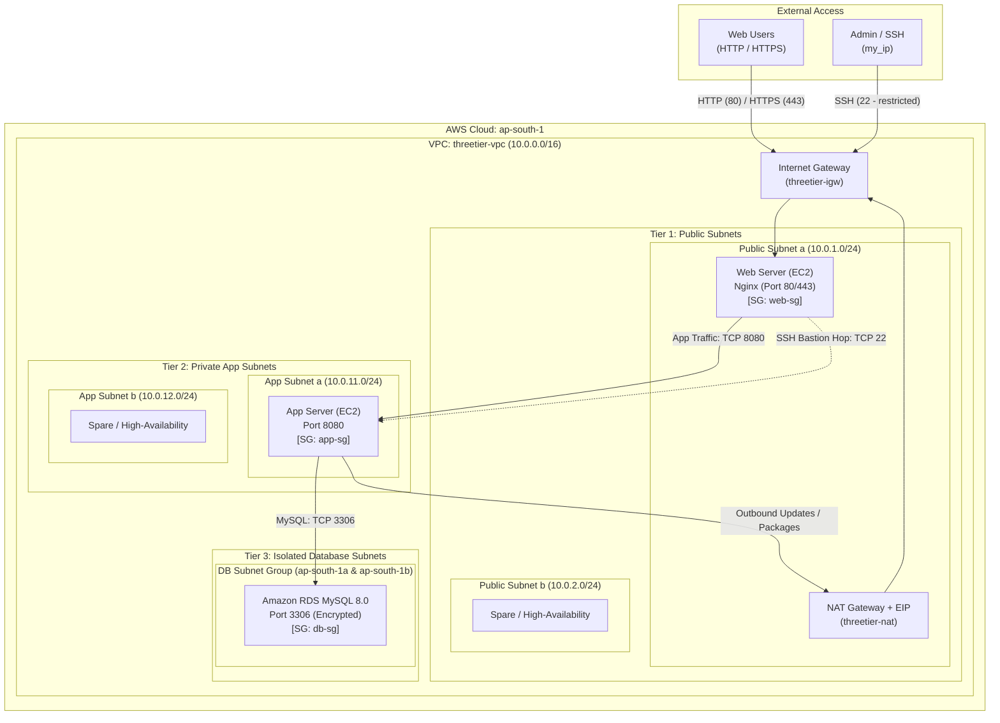

# 3-Tier AWS Infrastructure Architecture

This document describes the architectural layout, network topology, security model, and component interactions provisioned by the Terraform scripts in this repository.

---

## Architecture Diagram

---

## Architectural Highlights

### 1. Networking & Segmentation (`network.tf`)
- **VPC CIDR**: `10.0.0.0/16`
- **Multi-AZ Availability**: Subnets span across `ap-south-1a` and `ap-south-1b`.
  - **Public Subnets**: `10.0.1.0/24` (AZ-a), `10.0.2.0/24` (AZ-b)
  - **Private App Subnets**: `10.0.11.0/24` (AZ-a), `10.0.12.0/24` (AZ-b)
  - **Isolated DB Subnets**: `10.0.21.0/24` (AZ-a), `10.0.22.0/24` (AZ-b)
- **Gateways**:
  - **Internet Gateway (IGW)** attached to the VPC for incoming internet requests and admin SSH.
  - **NAT Gateway (with Elastic IP)** deployed in Public Subnet `a` to provide one-way egress internet access for private app servers (updates, package installations).

### 2. Tiered Security Group Rules (`security.tf`)
- **`web-sg`**:
  - Ingress: TCP 80, 443 from `0.0.0.0/0`
  - Ingress: TCP 22 from configured `var.my_ip` only
  - Egress: Full outbound access
- **`app-sg`**:
  - Ingress: TCP 8080 allowed **only** from `web-sg`
  - Ingress: TCP 22 allowed **only** from `web-sg` (acts as an internal jump host)
  - Egress: Full outbound access (routed through NAT Gateway)
- **`db-sg`**:
  - Ingress: TCP 3306 allowed **only** from `app-sg`
  - No direct ingress from Web tier or public internet

### 3. Compute Layer (`compute.tf`)
- Dynamic lookup for the latest **Amazon Linux 2023** AMI.
- **Web EC2 Instance**: Deployed in Public Subnet `a`, automatically configures Nginx web server via `user_data`.
- **App EC2 Instance**: Deployed in Private App Subnet `a`, conditionally created when `enable_nat = true`.

### 4. Database Layer (`database.tf`)
- **Engine**: MySQL 8.0 on `db.t3.micro`.
- **Storage**: 20 GB encrypted general-purpose storage.
- **Subnet Group**: Spans across database subnets in both AZs, with `publicly_accessible = false`.
